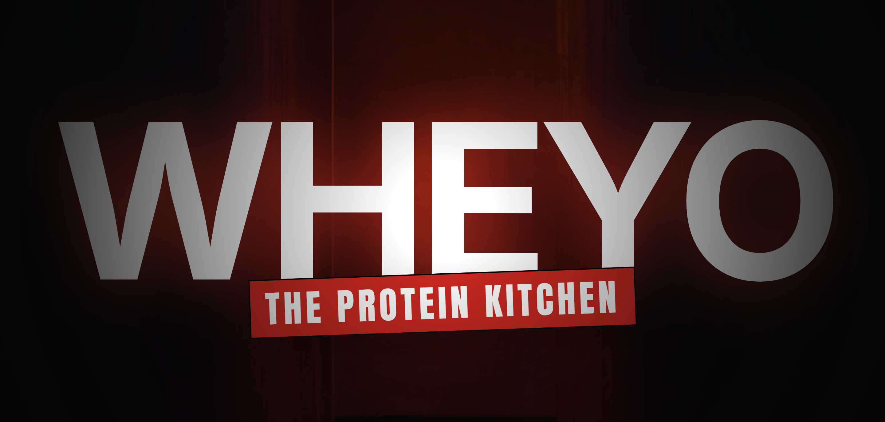

<div align="center">
  
  <br/>
  <p><strong>Belgaum's 1st Cloud Protein Kitchen & Gamified Athlete Fuel Ecosystem</strong></p>
  <p><i>Shattering the gap between cafeteria food and peak athletic performance.</i></p>

  <a href="https://wheyo.vercel.app"><strong>Visit Live Platform → wheyo.vercel.app</strong></a>
</div>

---

## 🍽️ The Wheyo Mission & Business Model

College students, gym-goers, and hostel athletes in university towns struggle with one universal challenge: **meeting daily protein intake without junk calories or inflated restaurant bills**. Traditional mess food is carb-heavy and lacking in clean protein, while gourmet fitness meals are expensive and inaccessible.

**Wheyo** solves this with a precision cloud kitchen model:
1. **Direct-to-Campus High-Protein Kitchen**: Chef-crafted, lab-verified macro bowls, wraps, and recovery shakes delivered directly to student extraction points across Belgaum (KLE Tech, KLS GIT, VTU, Jain College, JNMC, MMEC, AITM).
2. **"Train to Earn" Food Economy**: An algorithmic gamification engine where every logged workout (Gym sets, Calisthenics reps, 5K cardio runs) earns **Wheyo Points** (100 Points = ₹10 INR Real Discount), directly redeemable at cart checkout for instant food discounts.
3. **Belgaum Campus League**: Inter-college athletic rivalry where students log volume and calories to boost their college's leaderboard ranking and earn exclusive campus-wide meal drops.
4. **Custom Subscription Meal Plans**: Weekly & Monthly recurring macro plans tailored for bulking, cutting, or athletic maintenance with zero hassle.

---

## 🚀 How Everyone Should Use Wheyo

```
┌─────────────────┐       ┌─────────────────┐       ┌──────────────────┐       ┌─────────────────┐
│  1. Log Workout │ ────> │ 2. Earn Points  │ ────> │ 3. Auto Refuel   │ ────> │ 4. WhatsApp Drop│
│ 150+ Exercises  │       │ 100 Pts = ₹10   │       │ Anabolic Window  │       │ Campus Delivery │
└─────────────────┘       └─────────────────┘       └──────────────────┘       └─────────────────┘
```

### 1. Track Daily Workouts & Torched Calories
- Open the **Workouts** tab and choose between **Gym & Weights**, **Calisthenics**, or **Cardio**.
- Pick from **150+ categorized exercises** or load 1-tap preset routines (*Push Day, Pull Day, Leg Day, Calisthenics Mastery, 5K Shred*).
- Log your sets, weights, and reps. Our deterministic mathematical engine calculates your exact calories burned and volume lifted in real-time.

### 2. Earn Wheyo Points as Real INR Discounts
- Every logged workout rewards you with Wheyo Points in your digital balance.
- 100 Wheyo Points = ₹10 off real food orders.
- Points are automatically available as a discount slider in your Cart Drawer during checkout.

### 3. Hit Your Anabolic Recovery Window
- Immediately after finishing your workout, Wheyo computes your exact post-training protein deficit (e.g. `~35g–50g Protein`).
- Receive an automated recovery suggestion tailored to your session with 1-tap **+ Add to Plate** ordering.

### 4. Flex for Your College in the Campus League
- Join your campus (*KLE Tech, KLS GIT, VTU Belgaum, Jain College, JNMC Medics, MMEC, Angadi AITM*).
- Every kilogram lifted and kilometer run adds to your college's collective tonnage and ranking.
- Generate and download your personalized **Athlete Flex Pass** to share on social media.

### 5. Order Seamlessly with Zero Tedious Forms
- Add your favorite meals to your cart, apply your earned points discount, and confirm via 1-tap WhatsApp ordering.
- Fresh, hot, macro-dense meals arrive right at your campus extraction point.

---

## 🥩 The Core Menu & Macro Architecture

| Category | Signature Items | Protein | Purpose |
| :--- | :--- | :--- | :--- |
| **Power Bowls** | Smoked Herb Chicken Rice, Paneer Muscle Mash | 42g – 55g | Post-workout hypertrophy & mass |
| **High-Protein Wraps** | Peri-Peri Grilled Strips, Soya Protein Roll | 32g – 45g | Fast grab-and-go student fuel |
| **Recovery Shakes** | Whey Nitro Cold Brew, Peanut Butter Blast | 28g – 36g | Rapid anabolic glycogen replenishment |
| **Lean Salads** | Lemon Herb Grilled Chicken, Mediterranean Feta | 30g – 40g | Shredding, low-carb cutting & definition |

---

## 🏆 Key Platform Capabilities

- **150+ Master Exercise Catalog**: Full coverage across Chest, Back, Shoulders, Legs, Arms, Core, Calisthenics, and Cardio with live search and category filtering.
- **Client-Side Algorithmic Notification Engine**: Intelligent, local in-app and browser push notifications for post-workout refueling, hydration alerts, and campus rank updates.
- **Mobile-First & iOS Optimized**: Fluid bottom navigation dock, safe-area insets, touch-action ergonomics, and 16px input scaling to eliminate auto-zoom glitches.
- **Strict Boundary Security**: 100% deterministic mathematical calculations with zero AI prompt ingestion, input sanitization, and fraud-proof points clamping.
- **Instant WhatsApp Checkout**: Direct communication channel bridging the digital tracker with the physical cloud kitchen.

---

<div align="center">
  <p><strong>Wheyo — The Hustler's Pride.</strong></p>
  <p><i>Fueling University Athletes Across Belgaum.</i></p>
</div>
